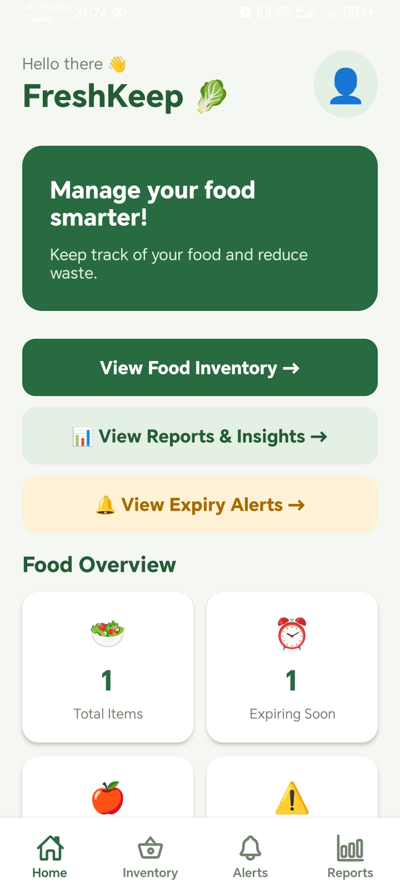
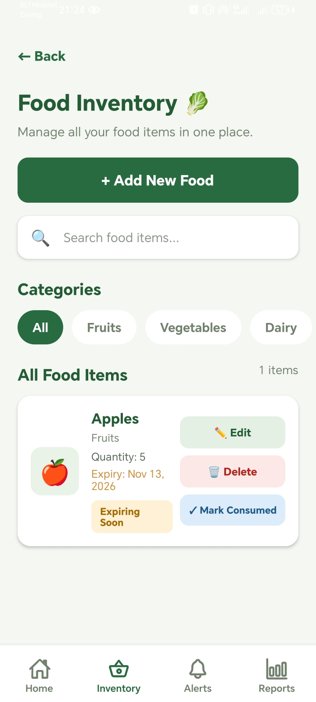
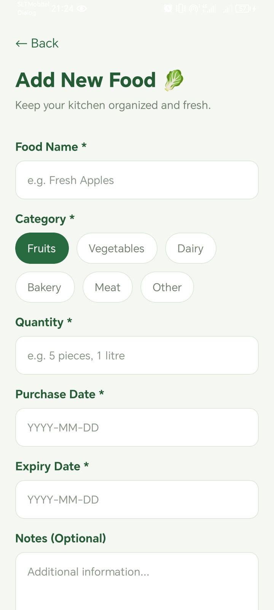
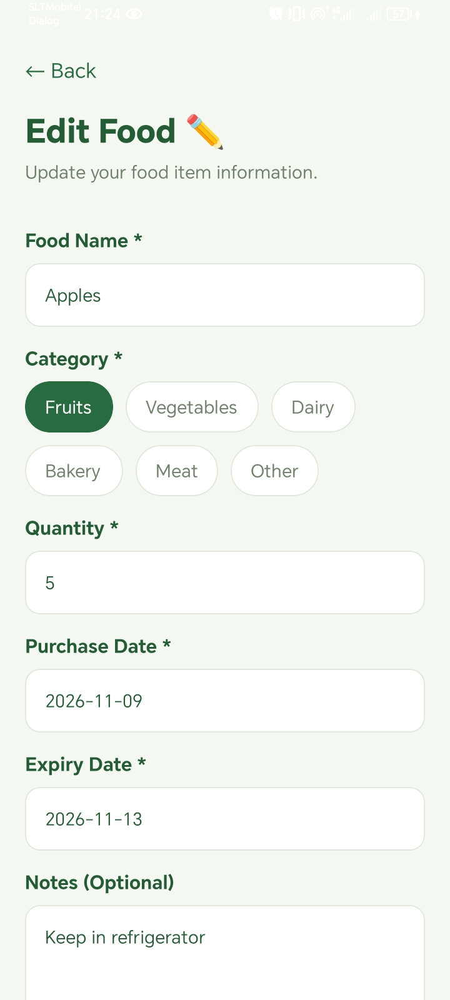
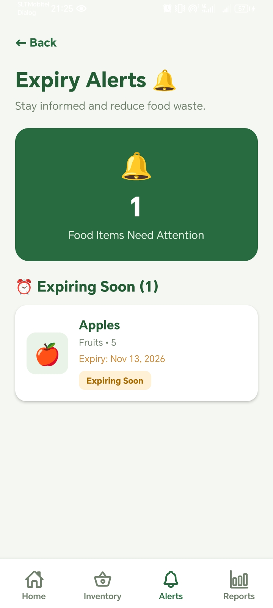
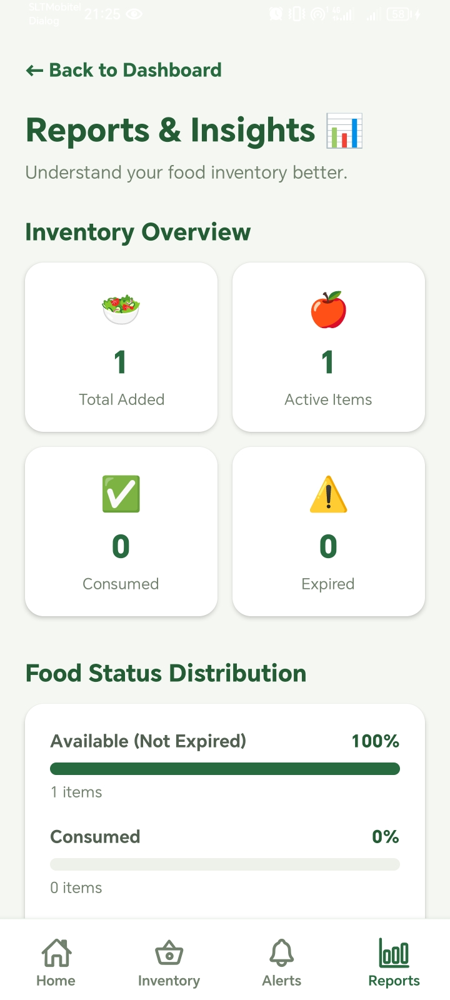

# 🥬 FreshKeep – Smart Food Inventory & Expiry Management App

FreshKeep is a React Native mobile application designed to help users manage their food inventory, monitor expiration dates, and reduce food waste.

The application provides an easy-to-use interface for adding, editing, deleting, and tracking food items. It also includes expiry alerts, food consumption tracking, and reports to help users manage their food efficiently.

## 📱 Features

### 1. Dashboard

- Displays an overview of food inventory.
- Shows total active, fresh, expiring, expired, and consumed food items.
- Displays recently added food items.
- Provides quick navigation to other screens.

### 2. Food Inventory Management

- View all saved food items.
- Search food items by name.
- Filter food items by category.
- View food quantities, expiry dates, and statuses.
- Edit and delete existing food items.

### 3. Add and Edit Food

- Add new food items with relevant details.
- Enter food name, category, quantity, purchase date, expiry date, and notes.
- Update previously saved food items.
- Validate food details before saving.

### 4. Expiry Tracking and Alerts

- Automatically calculate food expiry status.
- Categorize food items as:
  - Fresh
  - Expiring Soon
  - Expires Today
  - Expired
- Display expiry alerts based on food expiration dates.
- Exclude consumed items from expiry alerts.

### 5. Food Consumption Tracking

- Mark food items as consumed.
- Maintain consumed food records.
- Prevent already consumed items from being marked again.
- Update Dashboard and Reports statistics.

### 6. Reports and Analytics

- Display total added, active, consumed, and expired food counts.
- Show food consumption and expiry percentages.
- Display category-wise food distribution.
- Provide consumed food history.

### 7. Bottom Tab Navigation

Navigate between four main sections:

- Home
- Inventory
- Alerts
- Reports

### 8. Local Data Storage

- Store food inventory data using AsyncStorage.
- Preserve saved food items after restarting or refreshing the application.
- Perform inventory management without requiring a backend server.

## 🛠️ Technologies Used

| Technology        | Purpose                        |
| ----------------- | ------------------------------ |
| React Native      | Mobile application development |
| Expo              | Development and testing        |
| Expo Router       | Navigation and routing         |
| JavaScript / JSX  | Application development        |
| AsyncStorage      | Local data persistence         |
| React Hooks       | State management               |
| Expo Vector Icons | Navigation icons               |
| Git & GitHub      | Version control                |

## 📂 Project Structure

```text
FreshKeep/
├── assets/
├── src/
│   ├── app/
│   │   ├── (tabs)/
│   │   │   ├── _layout.jsx
│   │   │   ├── index.jsx
│   │   │   ├── inventory.jsx
│   │   │   ├── expiry-alerts.jsx
│   │   │   └── reports.jsx
│   │   ├── _layout.jsx
│   │   ├── add-food.jsx
│   │   └── edit-food.jsx
│   ├── storage/
│   │   └── foodStorage.js
│   └── utils/
│       └── expiryUtils.js
├── package.json
└── README.md
```

## 🚀 Installation and Setup

### Prerequisites

Make sure the following tools are installed:

- Node.js
- npm
- Visual Studio Code
- Git
- Expo Go (optional, for mobile testing)

### Step 1 – Clone the Repository

```bash
git clone https://github.com/Kaushalya-Sewwandi/FreshKeep.git
```

### Step 2 – Navigate to the Project Directory

```bash
cd FreshKeep
```

### Step 3 – Install Dependencies

```bash
npm install
```

### Step 4 – Start the Application

```bash
npx expo start
```

### Step 5 – Run on Web

```bash
npx expo start --web
```

Alternatively, use Expo Go to run the application on a compatible mobile device.

## 🧪 Testing

The application was manually tested to verify its main functionalities.

| Test Case ID | Test Scenario                        | Result |
| ------------ | ------------------------------------ | ------ |
| TC-01        | Add Food and Dashboard Update        | PASS   |
| TC-02        | Edit Food                            | PASS   |
| TC-03        | Mark Food as Consumed                | PASS   |
| TC-04        | Delete Food                          | PASS   |
| TC-05        | Expiry Alerts and Status Calculation | PASS   |
| TC-06        | Reports and Analytics                | PASS   |
| TC-07        | Navigation and Data Persistence      | PASS   |

**Testing Summary**

- Total Test Cases: 7
- Passed: 7
- Failed: 0
- Pass Rate: 100%

Testing was performed using the Expo web development environment. Android device testing and production build validation are not included in these results.

## 📸 Application Screenshots

### Dashboard



### Food Inventory



### Add Food



### Edit Food



### Expiry Alerts



### Reports and Analytics



## 🔮 Future Enhancements

The following features may be added in future versions:

- Push notifications for upcoming food expiration dates.
- Barcode scanning for faster food entry.
- Food image upload.
- Cloud database synchronization.
- User authentication.
- Shopping list management.
- AI-powered food recommendations.

## 🎯 Project Objective

The main objective of FreshKeep is to provide a simple and effective solution for managing household food inventory, tracking expiration dates, and encouraging better food consumption habits to minimize food waste.

## 👩‍💻 Developer

**Kaushalya Sewwandi**

GitHub: [Kaushalya-Sewwandi](https://github.com/Kaushalya-Sewwandi)

Project Repository: [FreshKeep](https://github.com/Kaushalya-Sewwandi/FreshKeep)

## 📄 License

This project was developed for educational purposes.
